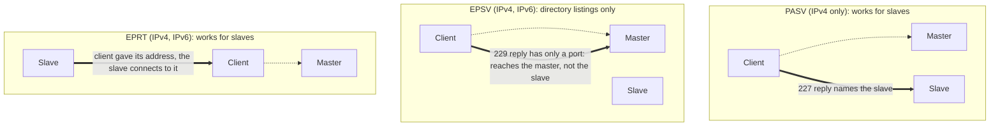

# RFC: IPv6 support for DrFTPD, phase 1 (PR #523)

2026-11-19

## Summary

IPv6 clients should be able to log in, list directories and transfer files, with file transfers in **active mode** (`EPRT`), because the IPv6 passive command (`EPSV`) cannot point a client at a slave.

- **Status:** Draft, for review alongside [PR #523](https://github.com/drftpd-ng/drftpd/pull/523)
- **Addresses:** [issue #19](https://github.com/drftpd-ng/drftpd/issues/19), "IPv6 support"
- **Scope:** phase 1 of 3. Phases 2 and 3 are outlined under [Future phases](#future-phases-and-open-questions).

Phase 1 adds the RFC 2428 commands `EPRT` and `EPSV`, fixes the master-to-slave `connect` argument for IPv6 addresses, makes IP masks match IPv6 addresses the way admins write them, and adds `ipsecurity6` rules so IPv6 masks can be added with site commands.

## Motivation

Today an IPv6 client can open the control connection but cannot transfer anything. The session in #19 (opened 2016, still asked about in 2025) shows every step failing:

```
[R] 227 Entering Passive Mode (0:0:0:0:0:0:0:1,219,195).
[R] PASV mode failed, trying PORT mode.
[R] EPRT |2|::1|1838|
[R] 502 Command not implemented.
```

| What the client tries | What happens today | Cause in the code |
| --- | --- | --- |
| `PASV` | A `227` reply with a garbled address | `DataConnectionHandler` builds the address with `replace('.', ',')`, which only works for IPv4 |
| `EPRT` / `EPSV` | `502 Command not implemented` | Neither command exists |
| Active transfer to an IPv6 client | Would fail even with `EPRT` | The slave splits the master's `ip:port` argument with `split(":")` |
| Adding an IPv6 IP mask with `SITE ADDIP` | Refused | Every `ipsecurity` rule expects four dot-separated parts |
| Matching a login against an IPv6 mask | Only Java's long form matches (`*@0:0:0:0:0:0:0:1`) | `HostMask` compares against `getHostAddress()` |

The last two mean IPv6 users can't even be set up: a login needs a matching mask, and the default IP security rules refuse IPv6 masks.

## Background

In drftpd the client talks to the master, but file data flows between the client and a slave; how the client learns where that is decides which FTP commands can work.

- **Passive mode** (`PASV`, `EPSV`): the server listens and its reply tells the client where to connect.
- **Active mode** (`PORT`, `EPRT`): the client listens and tells the server its address; the server connects to it.
- **`PRET`:** before `PASV`, drftpd requires `PRET <command>`, so the master can pick the slave first and ask it to listen. Transfers the master serves itself, such as listings, need no slave.

The data connection for a file transfer with `PASV`, `EPSV` and `EPRT` (dotted: control connection; thick: data connection):



`PASV` can name the slave but only carries IPv4 addresses. `EPSV` handles IPv6 but only carries a port, so the client connects back to the master. With `EPRT` the slave connects to the client, so the client never needs the slave's address.

## The core constraint: EPSV can't point at a slave

Over IPv6, passive-mode file transfers to slaves are not possible with standard clients, so phase 1 uses active mode for them.

[RFC 2428](https://www.rfc-editor.org/rfc/rfc2428) says the `EPSV` reply includes only the TCP port, and that the data connection uses the same network address as the control connection. The reply format leaves a placeholder for an address, but the RFC never defines using it. For drftpd, the control connection's address is the master's, while a file transfer is served by a slave.

Three options were considered (details under [Alternatives considered](#alternatives-considered)):

| Option | Works with standard clients | Phase 1 |
| --- | --- | --- |
| (a) Refuse `EPSV` for slave transfers; use active mode (`EPRT`) | Yes | **Chosen** |
| (b) Put the slave's address in the `EPSV` reply's placeholder | Only clients that accept it, untested | Possible later, behind a setting |
| (c) Proxy slave transfers through the master | Yes | No: defeats the distributed design |

Active mode fits drftpd's design: the client listens, and the slave chosen for the transfer connects to it, exactly as with IPv4 `PORT` today. `EPSV` remains useful for directory listings, which the master serves itself.

## Specification

The new commands follow RFC 2428; where drftpd departs from plain FTP, it is because of `PRET` and slaves.

### EPRT

`EPRT <d><net-prt><d><net-addr><d><tcp-port><d>`, for example `EPRT |2|2001:db8::1|5282|`.

- The delimiter is the first character, any printable ASCII character.
- `net-prt` 1 needs an IPv4 address and 2 an IPv6 address. IPv4-mapped IPv6 addresses (`::ffff:a.b.c.d`) count as IPv4.
- The address must be a literal. Host names are refused, so client input never causes a DNS lookup.
- After parsing, `EPRT` runs exactly the same checks as `PORT`: the NAT warning, the loopback note and the FXP note.
- The data connection is then set up as for `PORT`: the slave chosen for the transfer connects to the address.

### EPSV

`EPSV`, `EPSV <net-prt>` or `EPSV ALL`.

1. `EPSV ALL` is accepted with `200`. For the rest of the session `PORT`, `PASV`, `CPSV` and `EPRT` are refused with `500`, as RFC 2428 requires.
2. `EPSV <net-prt>` that doesn't match the control connection's protocol gets `522 Network protocol not supported, use (n)`.
3. Like `PASV`, `EPSV` needs a `PRET` first, so the master knows whether the master or a slave will serve the transfer.
4. If the master serves it (`LIST`, `NLST`, `MLSD`): the master listens and replies `229 Entering Extended Passive Mode (|||port|)`.
5. If a slave serves it: `500 EPSV can't be used for file transfers on this site, they go directly to a slave`, with a hint to use `EPRT`, `PORT`, or `PASV` over IPv4. The `PRET` is kept, so the client's usual fallback (`PRET`, `EPSV`, then `PASV`) still works.

### PASV

- Unchanged when the address to report is IPv4. That includes IPv6 clients whose slave has an IPv4 `pasv_addr`.
- When the address would be IPv6, `PASV` now refuses with `500` and suggests `EPRT` or `EPSV`, instead of sending a garbled `227`.

### Reply codes

| Situation | Reply |
| --- | --- |
| `EPRT` accepted | `200`, plus the same notes as `PORT` |
| `EPRT` from a private address while the control connection is public | `501` with the existing NAT explanation |
| `EPRT` or `EPSV` with an unknown protocol | `522 Network protocol not supported, use (1,2)` (or `(n)` for `EPSV`) |
| Malformed `EPRT` | `501` |
| `EPSV` for a master transfer | `229 Entering Extended Passive Mode (\|\|\|port\|)` |
| `EPSV` for a slave transfer, or without `PRET` | `500` with an explanation |
| `EPSV ALL` | `200`; later `PORT`, `PASV`, `CPSV`, `EPRT` get `500` |
| `PASV` that would report an IPv6 address | `500` with an explanation |

### FEAT and configuration

- `EPRT` and `EPSV` are listed in `FEAT` when configured.
- Both are new entries in `config/commands/ftp/core.conf.dist`, with `perms *` like `PORT` and `PASV`.

## Master–slave protocol

The slave now reads the master's `connect` argument correctly for IPv6 addresses; for IPv4 nothing changes on the wire.

- **Before:** the master sends `connect` with the argument `ip:port`, and the slave splits it with `split(":")`. An IPv6 address such as `2001:db8::1` produces several parts, so the port is read wrongly.
- **After:** the slave splits at the **last** colon and also accepts `[ipv6]:port`. The master sends the address in short form without a zone id (`2001:db8::1:5282`). A zone id like `%eth0` names an interface on the master, which means nothing on the slave.
- **Mixed versions:** an old slave still works with a new master for IPv4 clients, because the argument is unchanged for them. It fails for IPv6 clients, so master and slaves should be upgraded together.

The `listen` command (used for `PASV`) carries only flags, so it needs no change.

## IP masks and IP security

IPv6 masks are written in the usual short form, and a new `ipsecurity6` rule type decides which IPv6 masks users may add.

### Matching

`HostMask.matchesHost()` compares the mask's host part, a glob, against the client address in three forms, and matches if any of them does:

1. The short form from RFC 5952, without a zone id: `2001:db8::1`, `::1`.
2. Java's long form, without a zone id: `2001:db8:0:0:0:0:0:1`. This keeps masks written so far working, such as `*@0:0:0:0:0:0:0:1` from #19.
3. The host name, as before.

IPv4 matching is unchanged. Matching both forms also helps prefixes whose zero groups the short form compresses: `*@2001:db8:0:0:*` doesn't match the short form `2001:db8::1:0:0:5` but does match the long form `2001:db8:0:0:1:0:0:5`.

### ipsecurity6 rules

`ipsecurity` rules describe four dot-separated parts, so every IPv6 mask failed them and `SITE ADDIP` refused it. IPv6 masks are now checked only against a new line type in `ipsecurity.conf`:

```
#             IDENT  GROUPS  NUMIP  PERMS
ipsecurity6     0      4       3    *
```

- **GROUPS** (1 to 8) is the minimum number of leading 16-bit groups the mask must fix. 4 means at least a /64; 8 means a full address.
- A mask is either a full IPv6 address (8 groups), or explicit groups followed by `*`, such as `2001:db8:1:2:*` (4 groups).
- `::` before the `*` is refused (`2001:db8::*`), because the number of groups it stands for is ambiguous. Other wildcards are refused too.
- IDENT, NUMIP and PERMS work as in `ipsecurity` lines.
- `ipsecurity.conf.dist` ships `ipsecurity6 0 4 3 *`. Without any `ipsecurity6` line, IPv6 masks are refused, as today.
- `::1` is always accepted, like `127.0.0.1`.

## Compatibility and upgrading

IPv4 sites see no change unless their clients try `EPSV`; existing installs need two config additions to enable the IPv6 parts.

### Existing configuration

Command and IP security configs aren't overwritten on upgrade, so the new entries must be copied in by hand (noted in `MAJORCHANGES.txt`):

- [ ] Copy the `EPRT` and `EPSV` blocks from `config/commands/ftp/core.conf.dist` into `config/commands/ftp/core.conf`. Without them, both stay `502 not implemented`.
- [ ] Copy the `ipsecurity6` line from `ipsecurity.conf.dist` into `ipsecurity.conf`. Without it, IPv6 masks are refused.
- [ ] Upgrade the master and all slaves together.

### Behaviour for existing IPv4 clients

| Client behaviour | Before | After |
| --- | --- | --- |
| Uses `PASV` (most clients over IPv4) | Works | Unchanged |
| Tries `EPSV` first, e.g. curl and lftp | `502`, falls back to `PASV` | Listings use `EPSV`; transfers get `500` and fall back to `PASV` |
| Uses `PORT` | Works | Unchanged |
| Sends `EPSV ALL` | `502`, ignored | Accepted; the session can then only use `EPSV`, so file transfers fail |

The last row is the one real behaviour change for IPv4: a client that sends `EPSV ALL` promises to use nothing else, and file transfers need something else on this site. It is listed as an open question.

## Security considerations

No new kind of exposure is added: active mode already exists through `PORT`, and every check `PORT` does now also covers `EPRT`.

- **No DNS lookups from client input.** `EPRT` accepts only address literals, checked character by character before Java parses them. A host name in `EPRT` would otherwise make the master resolve names chosen by the client.
- **FXP and bounce.** `EPRT` can name an address other than the client's, like `PORT`. That is how FXP works, and the existing "FXP allowed" note applies. Like `PORT`, nothing here restricts which addresses or ports the slave connects to; a site that wants to limit FXP should do so for both commands, outside this RFC.
- **NAT detection.** The "you're behind a NAT router" refusal now also recognises IPv6 private addresses: unique local `fc00::/7` and link-local `fe80::/10`. Before, Java's `isSiteLocalAddress()` only knew the deprecated `fec0::/10`.
- **Breadth of IPv6 masks.** An IPv6 /64 usually belongs to one subscriber, much like a single IPv4 address. The default `ipsecurity6 0 4 3 *` therefore allows roughly what `X.X.X.*` allows for IPv4. Sites can require full addresses with `GROUPS` 8.
- **Zone ids** (`fe80::1%eth0`) are ignored when matching masks and dropped before addresses are sent to slaves.

## Alternatives considered

Each alternative either breaks standard clients or gives up drftpd's distributed design, so none is part of phase 1.

| Alternative | How it would work | Why not now |
| --- | --- | --- |
| Slave address in the `EPSV` reply | Fill the reply's unused address field: `(\|2\|2001:db8::5\|port\|)` | Not defined by RFC 2428; clients that follow it ignore the field and connect to the master. Worth testing with the clients sites use; could become a setting in phase 2. |
| `LPSV` / `LPRT` (RFC 1639) | The long-passive reply carries a full address, IPv6 included | An experimental RFC that few current clients use |
| Proxy slave transfers through the master | The master listens for `EPSV` and relays data to and from the slave | All transfer traffic would pass through the master, which is what slaves exist to avoid |
| Run a slave on the master's address | `EPSV` then points at the right host | Only covers single-host sites |
| Reject IPv6 control connections | Bind the master to IPv4 only | Leaves #19 unsolved; IPv6-only clients can't connect at all |

## Testing

The parsing and matching code is covered by 17 unit tests that pass in CI; the command handlers still need a manual test with an IPv6 client before #523 leaves draft.

### Unit tests in #523

| Test class | Tests | Covers |
| --- | --- | --- |
| `InetAddressUtilsTest` | 8 | Short form, private ranges, literal parsing (host names refused), `EPRT` parsing including the command from #19, `host:port` splitting, the `EPSV` reply |
| `HostMaskTest` | 3 new | IPv6 short and long form matching; IPv4 unchanged |
| `IpSecurityManagerTest` | 3 | Counting the fixed groups of IPv6 masks, invalid masks |

### Manual test plan

On a test install with one slave, both reachable over IPv6, and a user whose mask is `*@::1` (or the test machine's address):

1. Log in over IPv6 (`::1` or the host's address).
2. `FEAT` lists `EPRT` and `EPSV`.
3. `PRET LIST`, `EPSV`, `LIST`: the listing arrives through the master.
4. `PRET RETR <file>`, `EPSV`: refused with the active-mode hint; then `EPRT |2|<client address>|<port>|` and `RETR`: the file arrives from the slave.
5. The same with `STOR`.
6. `PASV` over IPv6 with an IPv6 `pasv_addr`: refused with the explanation, not a garbled `227`.
7. `EPSV ALL`, then `PORT`: refused.
8. `SITE ADDIP <user> *@2001:db8:1:2:*` accepted; `*@2001:db8::*` refused.
9. Repeat 3 and 4 with an IPv4 client to confirm nothing changed for it.

Clients worth trying: FileZilla, lftp, curl, and the scene clients sites use most.

## Future phases and open questions

Phases 2 and 3 make passive mode and IP rules work as well over IPv6 as over IPv4; four questions need reviewers' input first.

### Phase 2: passive addresses per protocol

- `pasv_addr6` for slaves and the master, next to today's single `pasv_addr`, chosen by the protocol of the client's control connection. Then `PASV` over IPv6 can still use a slave's IPv4 address, and listings over `EPSV` use the right master address.
- Decide on option (b): a setting that puts the slave's address in the `EPSV` reply, for sites whose clients accept it.

### Phase 3: IP rules

- Network ranges in IP masks, such as `*@2001:db8::/48`, for IPv4 and IPv6.
- Bring the IPv4 `ipsecurity` checks and the new `ipsecurity6` rules into one model.
- Review other address handling (logs, sitebot output, `SITE` commands that print addresses) to use the short form.

### Open questions

- [ ] **`EPSV ALL`:** accept it as RFC 2428 says, which makes file transfers impossible for that session, or refuse it with `500` so such clients keep using other commands?
- [ ] **`EPSV` reply code for slave transfers:** `500` (clients fall back to other commands) or something more specific? Real clients' fallback behaviour should decide.
- [ ] **Default `ipsecurity6` rule:** is at least a /64 (`GROUPS` 4) the right default for all users?
- [ ] **Upgrade friction:** should a missing `EPRT`/`EPSV` entry in an existing `core.conf` be added automatically, or is the note in `MAJORCHANGES.txt` enough? This ties in with #505 (command configs as `.dist` files).
