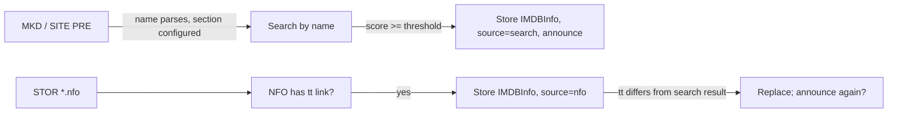

# RFC: IMDB lookup from the release name, without an NFO

2026-11-20

## Summary

The IMDB plugin should be able to find a movie from the release directory name when the directory is created, as the TvMaze plugin already does for TV shows, instead of waiting for an `.nfo` with an IMDB link.

- **Status:** Draft, for discussion
- **Addresses:** [issue #56](https://github.com/drftpd-ng/drftpd/issues/56), "Remove research by NFO (IMDB)"
- **Scope:** the master-side IMDB plugin (`src/plugins/imdb/imdb-master`). The NFO path stays; a name search is added in front of it, with a confidence check.

## Motivation

Today the IMDB announce and the IMDB metadata on a release only appear once an `.nfo` containing an IMDB link has been uploaded. The issue points out that the NFO is often transferred last (for example at the end of an FXP), so the information arrives after the race is over, and releases whose NFO has no IMDB link never get any.

The TvMaze plugin does not have this problem: it searches by the directory name on `MKD` and on `SITE PRE`. Users expect the same from IMDB.

## Background

How the IMDB plugin works today (all classes under `org.drftpd.imdb`):

| Step | Class | What it does |
| --- | --- | --- |
| Trigger on upload | `master.hooks.IMDBPostHook` | Post-hook on `doSTOR`: for a successful upload of a `*.nfo` (not `imdb.nfo`) in a configured race section, starts an `IMDBPrintThread` |
| Trigger on pre | `master.hooks.IMDBPREPostHook` | Post-hook on `doSITE_PRE`: same, for the pre'd directory, if its name does not match `exclude` |
| Read the NFO | `master.vfs.IMDBVFSDataNFO`, `master.IMDBIssuer`, `slave.IMDBHandler` | The master asks the slave holding the NFO to read it; `common.IMDBInfo.importNFOInfoFromFile()` extracts the `tt` id with the regex `.*/title/(tt\d+).*` |
| Fetch details | `master.IMDBParser.doNFO()` | Downloads `https://imdb.com/title/tt…/reference` and scrapes title, year, genres, rating, votes, runtime and so on from the HTML |
| Store and announce | `master.IMDBUtils.addMetadata()`, `publishEvent()` | Stores `IMDBInfo` on the directory under `IMDBInfo.IMDBINFO` and publishes an `IMDBEvent` |
| Manual search | `master.IMDB.doSITE_IMDB()` → `IMDBParser.doSEARCH()` | Scrapes `https://imdb.com/find?s=all&q=…` and takes the first `/title/tt` link |

So a name search already exists, but only for `SITE IMDB`, it takes the first hit without checking it, and it scrapes an HTML page whose layout has changed several times.

The TvMaze plugin (`org.drftpd.tvmaze.master`) shows the pattern to follow: `hooks.TvMazeHooks` runs on `doMKD` (when `TvMazeUtils.isRelease()` matches) and on `doSITE_PRE`; `TvMazeParser.getInfo()` strips season/episode, year and country tokens from the name with regexes, filters words from `filter.x`, and queries `https://api.tvmaze.com/search/shows?q=`, a documented public JSON API.

Other code reads the stored IMDB data: `org.drftpd.autonuke.master.imdb.IMDBConfig` can nuke on IMDB fields such as genre, year or rating. A wrong match is therefore not only a cosmetic problem.

## Proposal

### 1. Parse the release name

A new parser (proposed name `ReleaseNameParser`, in `imdb-master`) splits a scene name such as `The.Matrix.1999.REMASTERED.1080p.BluRay.x264-GROUP` into:

- **group:** the text after the last `-`;
- **tags:** known tokens, matched case-insensitively from a configurable list: resolution (`720p`, `1080p`, `2160p`), source (`BluRay`, `WEB`, `WEB-DL`, `HDTV`, `DVDRip`), codec (`x264`, `x265`, `H264`), edition and status (`REPACK`, `PROPER`, `INTERNAL`, `LIMITED`, `EXTENDED`, `UNRATED`, `REMASTERED`, `DC`), languages (`GERMAN`, `FRENCH`, …);
- **year:** the **last** 4-digit token between 1900 and the next year that comes before the first tag. Taking the last one handles titles that contain a year, such as `Blade.Runner.2049.2017…` and `1917.2019…`;
- **title:** the tokens before the year (or before the first tag if there is no year), with `.` and `_` turned into spaces.

Names that look like TV (`S01E02`, `S01`, `1x02`, the same patterns as `TvMazeParser`) are skipped; they are TvMaze's job, and `IMDBParser` already refuses non-movie pages.

### 2. Search, then score

The parsed title and year go to a search source (see below), which returns candidates with id, title, year and type. Each candidate gets a score:

| Check | Effect |
| --- | --- |
| Type is not a movie (or TV movie, configurable) | Rejected |
| Normalised titles equal (case, punctuation, `&`/`and`, leading `The`) | +60 |
| Otherwise, title similarity (token overlap) | 0 to +40 |
| Year equal | +40; year ±1: +20; differs by more: rejected |
| No year in the release name | No year points; a single exact title hit is still required |

Only a candidate at or above `search.min_score` (default 90, so an exact title plus the exact year) is used. If two candidates are within a few points of each other, nothing is used. Below the threshold the plugin logs the best candidate at debug level and stores nothing.

### 3. Order of sources



1. On `MKD` and `SITE PRE` in a configured section: name search, queued on the existing `IMDBThread` queue (`IMDBConfig.getDirToProcess()`), which already waits a random `delay.start` to `delay.end` seconds between items.
2. On NFO upload: the NFO link, if any, is authoritative and replaces a search result. If the NFO has no link and there is no search result yet, the name search runs at that point.
3. A manual `SITE IMDB` uses the same parser and scoring, but may show candidates below the threshold.

`IMDBInfo` gets a field saying where the id came from (`nfo`, `search`) and the score, so a later NFO can tell whether it should override.

### 4. Search sources

IMDb has no free official search API. The options:

| Source | How | Key | Terms and limits (as of writing, **unverified**, check before implementing) |
| --- | --- | --- | --- |
| IMDb suggestion endpoint | `https://v3.sg.media-imdb.com/suggestion/x/<query>.json`, used by the imdb.com search box; JSON with id, title, year, type | None | Undocumented, can change or be blocked without notice. IMDb's conditions of use forbid automated data collection without permission, which also applies to today's scraping |
| OMDb API | `https://www.omdbapi.com/?apikey=…&s=<title>&y=<year>&type=movie`, then `?i=tt…` for details | Free key, paid tiers | Free tier around 1,000 requests a day; data is crowd-sourced from IMDb |
| TMDb API | `/3/search/movie?query=…&year=…`, then `/3/movie/{id}/external_ids` for the IMDB id | Free key for non-commercial use | Requires attribution; rate limit around 40-50 requests a second |
| IMDb non-commercial datasets | Daily TSV dumps (`title.basics`, `title.ratings`) indexed locally | None | Personal and non-commercial use only; several hundred MB to download and index |

Proposal: a small interface (proposed `ImdbSearchSource`) with one implementation per source, chosen in `imdb.conf`. Default to the suggestion endpoint, because it needs no key and returns the IMDB id directly, with OMDb and TMDb as options for sites that prefer a documented API. Details keep coming from `IMDBParser.doNFO()` as today, so the search only has to produce a `tt` id.

### 5. Caching

- Results are cached in memory by normalised `(title, year)` → `tt` id, so the 720p, 1080p and 2160p releases of one movie cost one search. Default lifetime 7 days; failed searches 1 hour.
- Per-directory data stays where it is today, in `IMDBInfo` on the directory.
- At most `search.max_per_minute` searches; above that, requests stay in the `IMDBThread` queue rather than being dropped.

## Configuration

New keys in `imdb.conf.dist` (names are a proposal):

```
# Search IMDB by release name on MKD/PRE (true) or only use the NFO (false)
search.on_mkd=false
# Search source: suggest, omdb, tmdb
search.source=suggest
#search.omdb.apikey=
#search.tmdb.apikey=
# Minimum score (0-100) to accept a match
search.min_score=90
search.max_per_minute=30
search.cache.days=7
# Extra tag tokens that end the title (regex, case-insensitive)
#tag.x=
```

The existing `race.section.x`, `filter.x`, `exclude` and delay settings apply unchanged.

## Upgrade / compatibility

- Off by default (`search.on_mkd=false`), so existing sites see no change until they enable it.
- `IMDBInfo` gains two fields (`source`, `score`). The VFS stores plugin metadata as JSON; old entries without the fields read as `nfo`, which is what they are.
- `SITE IMDB` changes behaviour slightly: it uses the new parser and source instead of scraping `/find`.

## Security considerations

- **False matches feed autonuke.** An autonuke rule on IMDB genre, year or rating could nuke a release because of a wrong match. Options: autonuke ignores `source=search` data unless a setting allows it, or the threshold is high enough (open question 3).
- **API keys** live in `imdb.conf`, which is already admin-only; they must not appear in announces or logs.
- **Outbound requests** are built from directory names chosen by uploaders. The title is URL-encoded (as `IMDBUtils.filterTitle()` already does) and only fixed hosts are contacted.
- **Rate limits and blocking.** A busy site can be throttled or blocked by the source; the cache and `search.max_per_minute` limit this.

## Alternatives considered

| Alternative | Why not |
| --- | --- |
| Keep scraping `imdb.com/find` | HTML changes break it regularly; same terms-of-use issue; no year or type in a stable form |
| Pick the first search hit, as `SITE IMDB` does | Too many wrong matches for remakes and common titles |
| Only use the local IMDb dataset | Big download and index for a feature many sites will not use; good as an option, not as the default |
| Wait for the NFO but announce later | Does not address the issue |

## Test plan

- Unit tests for the name parser over a table of real-looking names: titles with years (`Blade.Runner.2049.2017`), numeric titles (`1917.2019`), no year, language and edition tags, TV names (skipped).
- Unit tests for scoring with fixed candidate lists: exact match, remake with a different year, two candidates with the same title and year (rejected).
- Each search source tested against recorded JSON responses, without network access in CI.
- Manual: enable on a test section, `MKD` a movie release and check the announce; upload an NFO with a different `tt` and check that it wins.

## Open questions

1. Which search source should be the default: the undocumented suggestion endpoint (no key) or a documented API that needs a key (OMDb or TMDb)?
2. When an NFO arrives with a different IMDB id than the search found, should the plugin announce again, or only update the metadata silently?
3. Should autonuke rules apply to IMDB data found by name search, or only to data from an NFO?
4. Is a default threshold of 90 (exact title and exact year) right, or should a missing year be allowed with a single exact title hit?
5. Should the `SITE IMDB` command keep its current scraping until the new code is proven, or switch at once?
