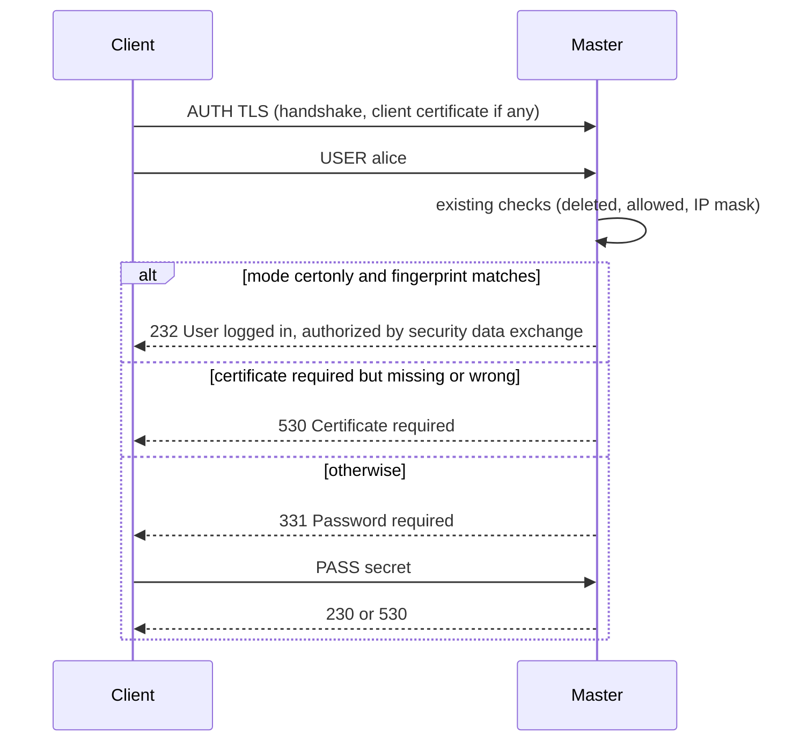

# RFC: FTP client certificate authentication

2026-11-20

## Summary

Users should be able to authenticate to the master with a TLS client certificate, pinned to their account by its SHA-256 fingerprint, either instead of the password or in addition to it.

- **Status:** Draft, for discussion
- **Addresses:** [issue #136](https://github.com/drftpd-ng/drftpd/issues/136), "FTP Client Certificate Authentication"
- **Scope:** the FTP control connection between clients and the master, after `AUTH TLS`. Slave data connections, bouncers and implicit TLS are discussed but not changed.

## Motivation

Logins are protected only by a password and an IP mask. A client certificate adds something that cannot be phished or guessed, and that a leaked userfile does not expose. Some FTP clients (for example lftp and curl) can present a client certificate; sites have asked for a way to use it.

The master-to-slave link is getting the same idea in open [PR #511](https://github.com/drftpd-ng/drftpd/pull/511), which pins each slave's certificate by fingerprint. Using the same fingerprint format for users keeps one model for admins.

## Background

- **TLS on the control connection.** `DataConnectionHandler.doAUTH()` (`src/core/master/.../commands/dataconnection/`) wraps the control socket with the `SSLContext` from `GlobalContext.getSSLContext()`, sets ciphers and protocols from `master.conf` (`cipher.whitelist.x`, `protocol.x`) and calls `startHandshake()`. It never calls `setWantClientAuth()` or `setNeedClientAuth()`, so the master does not ask clients for a certificate.
- **Trust.** That context comes from `SSLGetContext.getSSLContext()` (`src/core/common/.../network/`), which loads `config/drftpd.key` and installs a trust manager that accepts every certificate. If client certificates were requested, any certificate would pass the handshake; nothing would check who it belongs to.
- **`SSLService`** (`src/core/common/.../network/SSLService.java`) is the configurable TLS layer used for the master–slave link (`slavemanager.ssl.*` in `master.conf`, including `slavemanager.ssl.client_authentication=optional`). For FTP clients, client authentication appears there only in `SSLParametersToString()`, a debug string. It is not used for the FTP control connection.
- **Implicit TLS** is not implemented: `Master.start()` contains a commented-out "Reserved for Implicit SSL" block.
- **Login.** `LoginHandler.doUSER()` (`src/core/master/.../commands/login/`) looks the user up, checks deleted status, login permission and the IP mask, and replies `331`. `doPASS()` calls `User.checkPassword()` and replies `230`. `userrejectsecure` and `userrejectinsecure` in `perms.conf` (checked in `Master`) already let a site require TLS per user.
- **Bouncers.** A connection from a configured bouncer IP sends `IDNT` (`LoginHandler.doIDNT()`) with the real client's ident and address. TLS from the client ends at the bouncer, so the master sees the bouncer's TLS session, not the user's certificate.
- **User data.** Per-user settings live in the user's `KeyedMap` (`User.getKeyedMap()`), with keys declared as in `commands.usermanagement.UserManagement` (`TAGLINE`, `IRCIDENT`, …).

## Proposal

### TLS: request a certificate, accept any, check later

In `doAUTH()`, when `ssl.client_auth=want`, call `setWantClientAuth(true)` before the handshake. The trust manager keeps accepting any certificate; the TLS handshake still proves the client holds the private key (CertificateVerify). After the handshake, the master reads `getSession().getPeerCertificates()`, computes the SHA-256 fingerprint of the leaf certificate and stores it on the connection.

`need` (refuse the handshake without a certificate) is offered but not recommended: the certificate is requested before `USER`, so the master cannot yet know whether this user needs one, and every client without a certificate would fail.

### Mapping a certificate to a user

| Option | How | Verdict |
| --- | --- | --- |
| **SHA-256 fingerprint in the userfile** | The user's account lists one or more fingerprints; a match identifies the certificate | **Proposed.** Works with self-signed certificates, no CA to run, same format as PR #511 |
| Subject CN or DN equals the user name | Read the name from the certificate | Only safe if certificates come from a CA the site controls; with today's trust-all manager anyone can put any CN in a self-signed certificate |
| Private CA | Site runs a CA; trust only its certificates, map by CN | Needs a real trust store and revocation (CRL/OCSP); possible phase 2 |

Fingerprints are compared ignoring case, an optional `SHA256:` prefix, colons and spaces, so `openssl x509 -fingerprint -sha256` output can be pasted, as in PR #511.

### Login flow

The client still sends `USER`; the certificate is checked against the named user. Deriving the user from the certificate alone would need a non-standard command and is left as an open question.



Three modes per user, decided by `perms.conf` permissions (names are a proposal):

| Mode | Permission | Behaviour |
| --- | --- | --- |
| `password` (default) | none | As today; a presented certificate is ignored |
| `cert+password` (two factors) | `usercertrequired` | `USER` fails with `530` unless the session's fingerprint is on the account; then `PASS` is checked as usual |
| `certonly` | `usercertlogin` | A matching certificate logs the user in at `USER` with `232` (RFC 2228's reply for this case); without one, the normal password login applies unless `usercertrequired` also matches |

`232` is defined by RFC 2228, but some clients may still send `PASS` afterwards; the master should then answer `PASS` with `230` without checking it (or `503`, see open questions). Client behaviour here is **unverified**.

### Managing fingerprints

| Command | Who | Effect |
| --- | --- | --- |
| `SITE CERT` | Any user | Shows the fingerprint presented on this session and whether it is on the account |
| `SITE CERT ADD` | Logged-in user, `cert.selfadd` permission | Adds the session's fingerprint to the own account (enrolment: log in with a password over TLS with the certificate, then run this) |
| `SITE CERT DEL <fp>` | Owner or admin | Removes a fingerprint |
| `SITE CERT LIST [user]` | Owner; admin for other users | Lists fingerprints with the date added |
| `SITE CHANGE <user> cert add/del <fp>` | Admin | Same for another user, as a new field in `UserManagementHandler.doSITE_CHANGEUSER()`; also from IRC through the sitebot's command config |

Fingerprints are stored in the user's `KeyedMap` under a new key (proposed `UserManagement.CERT_FINGERPRINTS`) as a list of strings with an added date. Whether the userfile serialisation handles a list type cleanly is **unverified**; a delimited string is the fallback.

### Revocation

With pinning, revoking a certificate means deleting its fingerprint (`SITE CERT DEL`). Already logged-in sessions are not affected; `SITE KICK` exists for that. Expiry dates in self-signed certificates are ignored, as with PR #511. CRL and OCSP only matter for the private-CA option and are out of scope.

### Logging

- Debug: fingerprint presented on each handshake.
- Info: successful login with the method used (`password`, `cert`, `cert+password`) and the fingerprint.
- Failed logins set `FAILEDREASON` as today, with new values such as `CERT Missing` and `CERT Mismatch`, so the existing failed-login handling and announces see them.
- Certificates themselves are not logged; fingerprints are not announced on IRC.

## Configuration

`master.conf`:

```
# Ask FTP clients for a TLS client certificate during AUTH TLS: none, want, need
ssl.client_auth=none
```

`perms.conf` (defaults off):

```
#usercertrequired  =siteops
#usercertlogin     =trusted
```

New commands in `config/commands/ftp/core.conf` and the IRC command config, with permissions like other `SITE` user commands.

## Upgrade / compatibility

- Defaults change nothing: no certificate is requested, all users stay in `password` mode.
- With `want`, clients without a certificate send an empty certificate message and continue as today. Clients that prompt the user or fail when asked for a certificate are possible; this needs testing with the clients sites use (**unverified**).
- Command configs are not overwritten on upgrade; the new `SITE CERT` entries must be copied by hand (noted in `MAJORCHANGES.txt`).
- Bouncer users cannot use certificate login; a user with `usercertrequired` behind a bouncer cannot log in. Admins must not apply the permission to bouncer users.

## Security considerations

- **Trust-all is acceptable for pinning, not for name mapping.** Because any certificate passes the handshake, only a fingerprint match proves the user's identity. CN/DN mapping must not be added without a real trust store.
- **Private key possession** is proven by the TLS handshake; the fingerprint is not a secret, so knowing it does not allow a login.
- **`certonly` weakens nothing** compared with a password only if the private key is protected on the client; sites that want two factors should use `cert+password`.
- **Bouncers** could forward a fingerprint in `IDNT`, but the master would then trust the bouncer's claim; out of scope here.
- **TLS session resumption**: the peer certificates are part of the resumed session in Java, so the fingerprint is still available; renegotiation that changes the certificate is not expected, but the fingerprint should be read once, at `USER`.

## Alternatives considered

| Alternative | Why not |
| --- | --- |
| Use `SSLService` with `client_authentication` and a trust store for FTP clients | Bigger change to how the control connection's TLS is built; useful later for the private-CA option |
| TOTP codes in the password (`pass:123456`) | A different feature; could be a separate RFC for two factors without certificates |
| Certificate replaces `USER` entirely | Non-standard; clients always send `USER` |

## Test plan

- Unit tests: fingerprint normalisation and comparison (shared with PR #511 if it is merged), mode decision table for every combination of permission, certificate present/absent/matching.
- Integration: a test `SSLSocket` client with a keytool-generated certificate runs `AUTH TLS`, `USER`, and checks `232`, `331` and `530` replies.
- Manual with lftp (`ssl:cert-file`, `ssl:key-file`) and curl (`--cert`, `--key`): enrol with `SITE CERT ADD`, log in with each mode, remove the fingerprint and confirm login fails.
- Regression: FileZilla and other clients without a certificate still log in with `ssl.client_auth=want`.

## Open questions

1. Should certificate-only login (`232` at `USER`) be offered at all, or only certificate plus password?
2. After a `232`, should a `PASS` from the client be accepted silently (`230`) or refused (`503`)?
3. Is self-enrolment with `SITE CERT ADD` acceptable, or must an admin add every fingerprint?
4. Should the user be identified by the certificate alone (no `USER` match needed), for example with `USER *`?
5. Should this share code and the fingerprint format with the slave pinning in PR #511, which means merging #511 first?
