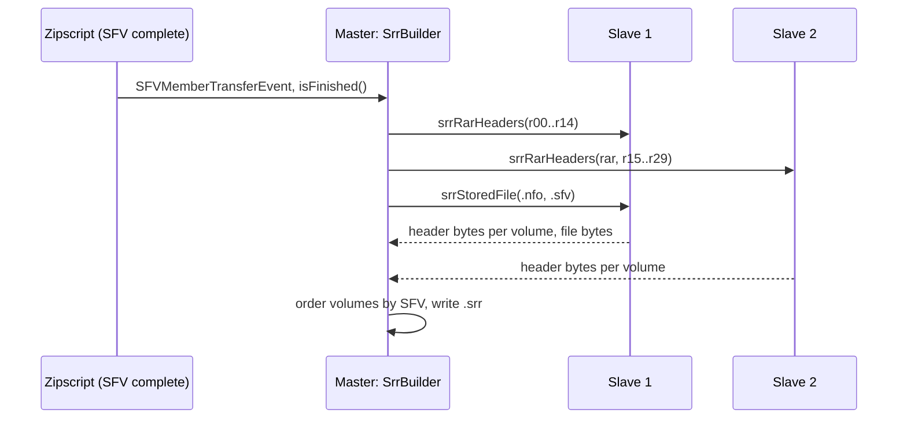

# RFC: srrDB plugin (building SRR files for releases)

2026-11-20

## Summary

A new plugin builds a ReScene `.srr` file for a release once its race is complete, by asking each slave for the RAR headers and small files it holds and assembling them on the master. Uploading to srrdb.com comes in a second phase.

- **Status:** Draft, for discussion
- **Addresses:** [issue #137](https://github.com/drftpd-ng/drftpd/issues/137), "Plugin : srrDB"
- **Scope:** phase 1, build `.srr` files locally from RAR volumes and stored files. Phase 2, sample `.srs` files, lookup and optional upload to srrdb.com, is outlined.

## Motivation

An SRR file lets anyone holding the extracted content rebuild the original RAR volumes bit for bit, and lets a site check a release against the srrDB archive. The issue asks for SRRs generated as releases arrive, and optionally uploaded to [srrdb.com](https://www.srrdb.com/).

In the issue thread, a maintainer of pyReScene (the reference SRR tool) explains that **all** RAR volumes have to be processed, and suggests that the master builds the SRR from metadata the slaves provide. Another commenter notes that reading every volume would not work if all volumes had to be on one slave. This RFC follows the pyReScene suggestion: each slave parses only the volumes it holds, and nothing large moves between machines.

## Background

### What an SRR contains

An SRR file uses RAR-style blocks. Descriptions below follow the pyReScene documentation; exact block layouts are to be checked against it during implementation (**unverified** in detail here).

| Block | Content |
| --- | --- |
| SRR header | Format marker and the name of the creating application |
| Stored files | Small files from the release kept whole: `.nfo`, `.sfv`, and optionally `.jpg`, `.png`, `.cue`, `.log`, `.m3u` |
| SRR RAR file | The name of a RAR volume; the RAR blocks that follow belong to it |
| RAR blocks | Every header block of that volume (marker, archive header, file headers, sub-blocks, end of archive), with the packed file data and recovery record data left out |
| Sample `.srs` (optional) | A stored file built from the sample video or audio: container structure without media data, plus track signatures (pyReSample) |
| OSO / ISDb hash (optional) | Needs the first and last 64 KB of the archived file |

Packed data is left out because it is the content itself; the headers, with their CRCs, sizes and flags, are what cannot be recreated. Each volume has its own headers, so one missing volume means the SRR cannot rebuild the set. This is why every volume must be read.

Reading headers is cheap: in a scene RAR volume the headers are at the start and the end, and the packed data in between is skipped with a seek using the size in the file header. The cost is a few small reads per volume, not a full read of the file.

### What DrFTPD has today

- **Plugins with a slave part** follow one pattern: a master-side issuer extending `AbstractIssuer` (`src/core/common/.../protocol/`) sends a command, a slave-side handler extending `AbstractHandler` (`src/core/slave/.../protocol/`) and registered with `SlaveProtocolCentral` answers with an `AsyncResponse` subclass. Examples: `IMDBIssuer`/`IMDBHandler` (reads an NFO on the slave), `MediaInfoIssuer`/`MediaInfoHandler`, `ZipscriptHandler.handleSfvFile()`.
- **The master–slave link** carries Java-serialised objects (`ObjectOutputStream` in `Slave`), so a response can hold a byte array of a few KB without any new framing.
- **Where files are:** `FileHandle.getSlaves()` returns the slaves holding a file. Volumes of one release are often spread over several slaves.
- **Race completion:** there is no dedicated "race complete" event. `SFVAnnouncer` (`zipscript-master`) listens to `SFVMemberTransferEvent`, checks `getSFVStatus().isFinished()` and marks the directory with the `SFV_COMPLETE` metadata key.
- **No RAR parsing** exists in the code base today, and there is no command that lets the master write a file on a slave; the basic slave commands (`BasicHandler`) are transfer, delete, rename, checksum, remerge and similar.

## Proposal

### Components



Proposed new module `src/plugins/srr` with `srr-common`, `srr-master` and `srr-slave`, like the IMDB and mediainfo plugins:

- **Slave: `SrrHandler`.** `handleRarHeaders(path)`: opens the volume, walks the RAR blocks, copies each header block and skips packed data and recovery record data; returns the volume name, size and the header bytes. `handleStoredFile(path, maxBytes)`: returns the content of a small file, refusing files above `maxBytes`. Both are read-only.
- **Master: `SrrIssuer`, `SrrBuilder`.** On completion, for each file in the SFV, pick an online slave from `FileHandle.getSlaves()`, request its headers, request the stored files, then write the blocks in SFV order (which is the volume order).
- **RAR parser:** a small Java implementation of block walking for RAR 4, following pyReScene's algorithm so unusual archives are handled the same way. RAR 5 support depends on what the SRR format and pyReScene support (**unverified**); phase 1 skips RAR 5 releases with a log line.

### When to build

- After the race completes: the first `SFVMemberTransferEvent` whose `SFVStatus.isFinished()` is true, in a configured section, queued on a single worker thread with a delay (default 30 s) so late NFOs and sample folders are included.
- `SITE SRR <dir>` builds or rebuilds on demand.
- Not rebuilt automatically when files change later; nuked releases are skipped.

### Storage

Phase 1 stores SRRs on the master, outside the VFS, in a configurable directory mirroring the section path: `srr/<section>/<release>.srr`. This needs no new slave write command and does not change the release directory, its listing, dupe checks or statistics.

Putting the SRR into the release directory (as a file on a slave) is attractive for users but needs a new "write file" slave command and decisions about owner, credits and SFV checks; see open questions.

### Phase 2

- **Samples:** build an `.srs` from the `Sample/` directory on the slave holding it (needs a port of pyReSample's container parsing for MKV, MP4, AVI; reads the whole sample, typically tens of MB).
- **Lookup:** query srrDB for the release name; if it exists, compare our volume CRCs with srrDB's to flag bad or modified releases, and skip upload.
- **Upload:** optional, off by default, with account credentials in the plugin config. srrDB documents a read API (search, details); the upload method for automated clients, and whether srrDB accepts automated uploads, is **unverified** and must be agreed with the srrDB operators first.

## Configuration

`srr.conf.dist` (proposal):

```
# Sections where SRRs are built
#section.1=MOVIES-X264
srr.dir=srr
build.delay.seconds=30
# Stored files to include (regex on file name)
stored.include=(?i).*\.(nfo|sfv|jpg|png|cue|log|m3u)$
stored.max_kb=512
# Phase 2
#srrdb.lookup=false
#srrdb.upload=false
#srrdb.upload.delay.hours=24
#srrdb.username=
#srrdb.password=
```

## Upgrade / compatibility

- New optional plugin; nothing changes unless it is enabled.
- Master and slaves must both have the plugin; a slave without `SrrHandler` answers with an error and the build is marked incomplete.
- Mixed slave versions are handled the same way as for other plugin handlers.

## Security considerations

- **Parsing untrusted files on slaves.** RAR volumes are uploaded by users and may be crafted. The parser must bound every size it reads, refuse header blocks above a limit, and never allocate based on an unchecked length.
- **Stored file size** is capped (`stored.max_kb`), so a `.jpg` of 2 GB cannot be pulled over the slave link.
- **Path handling:** the master only asks for files that exist in the VFS of the release; the slave resolves them through its roots as other handlers do.
- **Uploading leaks information.** An upload to srrDB shows that the site has the release, and when. Some sites and groups forbid this. Upload must be off by default, with a delay option, and only by explicit choice of the site.
- **Credentials** for srrDB are stored in the plugin config and never logged or announced.

## Alternatives considered

| Alternative | Why not |
| --- | --- |
| Copy all volumes to one slave and run pyReScene there | Moves gigabytes per release and needs Python on slaves |
| Build the SRR on the slave holding most volumes | Still needs the others' headers sent to it; the master is the natural place to combine |
| Use an existing Java RAR library (junrar) | Built for extraction; would need changes to give raw header bytes, and its licence terms need review (**unverified**) |
| Store SRRs as VFS metadata | Bloats the VFS JSON files by tens of KB per release |

## Test plan

- Unit tests for the RAR block walker against small RAR 4 sets generated in tests, including multi-volume, recovery record, comment and old-style volume names (`.rar`, `.r00`).
- Build an SRR from a test release and verify it with pyReScene (`srr -l` to list, and a reconstruct from the extracted content) outside CI.
- Distribution test: volumes spread across two test slaves; one slave offline gives an "incomplete" result, not a broken SRR.
- Crafted RAR headers with huge sizes or truncated blocks are rejected without large allocations.

## Open questions

1. Where should SRRs live: on the master outside the VFS (proposed), or as a file in the release directory on a slave?
2. Should the plugin be allowed to upload to srrDB at all, and only after srrDB's operators confirm automated uploads are welcome?
3. Is RAR 4 only acceptable for phase 1, given what the scene uses today?
4. Should the RAR parsing be ported from pyReScene (licence compatibility with GPL v2 to confirm) or written from the format description?
5. Should phase 2 lookups flag CRC mismatches against srrDB in the race announce, which would make srrDB a release validator?
